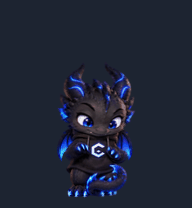
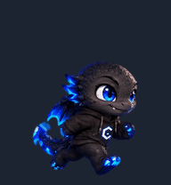

# CodeDragon V2 — revisão 2

Dragão chibi preto, de olhos azuis, asas e cauda neon, moletom preto com capuz e emblema angular. Esta é uma **revisão posterior à V2 já importada e ativa**, conforme informado pelo proprietário. Atualizar este repositório não altera a entrada instalada.

Projeto pessoal e independente, sem vínculo ou endosso da OpenAI.

## O que mudou

- **Sem chifres nos 73 quadros**, incluindo os 16 olhares. A cabeça tem contorno arredondado e natural, preservando as escamas, os olhos, as pequenas orelhas laterais, asas, cauda, capuz e emblema.
- **Trabalho no computador:** os seis quadros de `running` mostram o dragão sentado em um banquinho, diante de monitor e teclado sobre mesa compacta. As patas alternam a digitação, com pequenas mudanças de cabeça, expressão, asas e cauda e reflexo azul da tela. A perspectiva permite ver o rosto e o emblema.
- **Energia azul mais forte:** os oito quadros de cada corrida têm reflexos, brilho e pequenos prolongamentos azuis ligados às patas, asas e cauda. As direções usam arte própria; o emblema não foi espelhado.
- Todos os estados foram refeitos a partir da referência sem chifres para manter consistência. Idle mantém respiração/piscada; espera, revisão, saudação e erro conservam gestos distintos. O salto conserva cinco fases e a elevação de 55 px da V2 anterior.
- Fontes e prompts entram no build reproduzível, com verificação de hashes, novas prévias e evidências vinculadas aos novos bytes.





## Rastro ao arrastar: limite verificado

**Rastro persistente externo ao sprite não implementado: não há suporte exposto nas ferramentas/documentação consultadas.** A [documentação oficial de Pets](https://learn.chatgpt.com/docs/pets), consultada em 16/10/2026, descreve seleção, apresentação e importação, mas não estabelece callbacks de arraste nem uma API de partículas ou desenho persistente sobre a tela. As ferramentas Pets disponíveis validam e gerenciam pets; não oferecem esses pontos de extensão. O manifesto descreve a grade e os olhares.

A aproximação visual é o brilho e o curto rastro **embutidos na animação de locomoção**. Esses pixels acompanham o sprite; não ficam nas posições por onde ele passou e não têm temporizador independente. O aplicativo controla quando reproduz cada estado. Nenhuma alteração interna do Codex, injeção, overlay adicional, áudio, voz, som ou TTS foi feita. [Evidência de capacidades consultadas](assets/qa/drag-capabilities.json).

## Prévias e comparações

As comparações mostram **V2 anterior → V2 revisão 2**, com a versão anterior recuperada do commit `6b3add4`.

| Estado | Quadros | Prévia | Comparação |
| --- | ---: | --- | --- |
| idle | 6 | [GIF](assets/previews/idle.gif) | [Antes/depois](assets/previews/idle-comparison.gif) |
| running-right | 8 | [GIF](assets/previews/running-right.gif) | [Antes/depois](assets/previews/running-right-comparison.gif) |
| running-left | 8 | [GIF](assets/previews/running-left.gif) | [Antes/depois](assets/previews/running-left-comparison.gif) |
| waving | 4 | [GIF](assets/previews/waving.gif) | [Antes/depois](assets/previews/waving-comparison.gif) |
| jumping | 5 | [GIF](assets/previews/jumping.gif) | [Antes/depois](assets/previews/jumping-comparison.gif) |
| failed | 8 | [GIF](assets/previews/failed.gif) | [Antes/depois](assets/previews/failed-comparison.gif) |
| waiting | 6 | [GIF](assets/previews/waiting.gif) | [Antes/depois](assets/previews/waiting-comparison.gif) |
| running (trabalho) | 6 | [GIF](assets/previews/running.gif) | [Antes/depois](assets/previews/running-comparison.gif) |
| review | 6 | [GIF](assets/previews/review.gif) | [Antes/depois](assets/previews/review-comparison.gif) |

- [Contato dos 73 quadros](assets/previews/contact-sheet.png), [todos os estados em GIF](assets/previews/all-states.gif) e [MP4 sem áudio](assets/previews/all-states.mp4).
- [Salto e retorno ao idle](assets/previews/idle-success-idle.gif), [cinco fases do salto](assets/previews/success-frames.png).
- [16 olhares rotulados](assets/previews/look-directions.png), [olhares em sequência](assets/previews/look-directions.gif).
- [Transparência sobre fundos claro/escuro](assets/previews/alpha-mattes.png).

Todas as prévias são derivadas do PNG final codificado. Os fundos de demonstração e rótulos ficam nas prévias. Os tempos dos GIFs não configuram o reprodutor nativo.

## Compatibilidade e evidências

- PNG RGBA transparente, **1536 × 2288 px**, formato v2, grade **8 × 11**, células **192 × 208 px**.
- **73 células ocupadas e 15 vazias**, contagens `6/8/8/4/5/8/6/6/6/8/8`.
- Nomes e posições dos estados e manifesto preservados. Os 16 olhares foram refeitos para remover os chifres e revalidados na ordem horária em passos de 22,5°.
- SHA-256 da spritesheet: `e5420e75ae9ca6c9a1d54f13b771d5e1b4a3d5a13d5331a4ddd31987ad62a7b5`.
- Testes e resultados: [relatório detalhado](docs/v2-validation.md), [validação local](assets/qa/local-validation.json), [preflight oficial](assets/qa/pets-validation.json), [regressões](assets/qa/regression-tests.json).

As verificações estruturais e assinaturas dos quadros não demonstram semântica ou fluidez sozinhas. A revisão visual, os avisos e o alcance de cada teste estão registrados no relatório. A reprodução desta revisão com eventos reais do aplicativo depende de importação e avaliação posterior; **nenhuma entrada instalada foi substituída, criada ou selecionada nesta entrega**.

O preflight oficial retornou `valid: true`, os validadores locais e o quality gate passaram, e **15 testes de regressão** foram aprovados. Uma segunda reconstrução gerou bytes idênticos. A revisão cega por três revisores confirmou os quatro cardinais. Permanecem avisos revisados nas direções intermediárias 67,5°, 112,5°, 202,5°, 247,5° e 292,5°, e nas transições 157,5° → 180° e 337,5° → 0°; a primeira tem variação de área visível de 1,24×. Não foram observados buracos de alpha nem defeitos de registro bloqueantes. [Evidências e limites](docs/v2-validation.md).

## Atualizar preservando a V2 instalada

1. Mantenha as entradas CodeDragon original e CodeDragon V2 existentes. Guarde uma cópia da spritesheet instalada antes de qualquer substituição controlada.
2. Baixe [spritesheet.png](pets/codedragon/spritesheet.png) e confira o SHA-256 acima. O manifesto auxilia a inspeção; não instala nem configura eventos.
3. Em um fluxo com o plugin Pets compatível com v2, anexe o PNG e solicite: **“Valide esta spritesheet pronta, sem redesenhar. Crie uma nova entrada CodeDragon V2 revisão 2, preservando as entradas existentes e o pet ativo.”**
4. O fluxo suportado é `validate_pet_spritesheet` → `prepare_pet_upload` → `create_pet`. Criar a entrada não a seleciona. Avalie a revisão e peça separadamente sua ativação com `select_pet`, mantendo a V2 anterior para retorno.
5. Se preferir substituir a entrada V2 existente, autorize explicitamente uma atualização pelo ID estável com `update_pet`, depois de salvar a arte anterior. Essa atualização não foi executada aqui.

A atualização depende de **nova importação ou atualização controlada**; um `git pull` não modifica o pet ativo. A documentação pública de upload web descreve v1 (1536 × 1872), enquanto o plugin consultado oferece preflight v2. Use um fluxo que aceite v2; não redimensione nem corte o atlas para v1.

## Desenvolvimento

```sh
python -m pip install -r tools/requirements-dev.txt
python tools/build_v2.py
python tools/validate_v2.py
python tools/test_validation.py
```

O build usa fontes versionadas em `assets/source/v2-r2/`, verifica seus hashes, extrai os componentes, registra a escala e o apoio, monta o atlas e gera as prévias. Não depende de novas chamadas de geração. [Método, ferramentas e reprodução](docs/v2-r2-authoring.md).

Arquivos principais: `pets/codedragon/spritesheet.png`, `tools/build_v2.py`, `tools/validate_v2.py`, `tools/test_validation.py`, fontes, prévias, QA e documentação. A referência histórica original está preservada em `assets/reference/codedragon.png`.

O trabalho continua na branch `feat/codedragon-v2-animations` e no [PR #1 existente](https://github.com/PedroCostinha/codex-codedragon/pull/1). A `main` não recebe merge automático.
