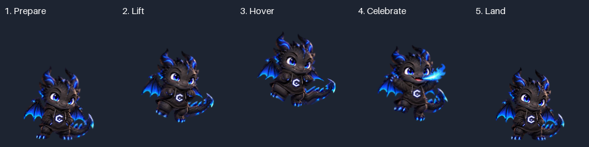
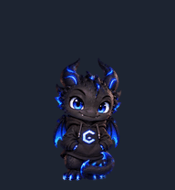

# CodeDragon V2

Mascote animado de um pequeno dragão chibi preto, com olhos azuis e detalhes em azul neon, criado para acompanhar sessões de programação. A V2 refina os **57 quadros dos nove estados de animação**, preservando integralmente as **16 poses de olhar** da versão original.

**Projeto pessoal e independente. Não é um produto oficial da OpenAI e não representa vínculo ou endosso da empresa.**


## Identidade e técnica

Continuam presentes as escamas pretas, os olhos azuis, dois chifres, duas asas, cauda, moletom preto com capuz e seu emblema angular. A referência original e o manifesto permanecem inalterados.

A edição é programática, conforme permitido na missão: movimentos locais em torno de pescoço, ombros, patas e raiz da cauda aproveitam o desenho aprovado. Cada pose é amostrada uma única vez em RGBA pré-multiplicado para evitar bordas escuras. O emblema tem uma região protegida contra deformação. Nenhuma direção foi produzida espelhando o moletom; cada corrida usa sua própria arte original. Não houve geração de outro personagem nem chamada de ImageGen nesta versão.

## Melhorias implementadas e antes/depois

| Linha¹ / estado | Quadros | Original → V2 | Comparação |
| --- | ---: | --- | --- |
| 0 / `idle` | 6 | Respiração e piscada existentes → peito/cabeça respiram com asas, cauda e olhar acompanhando; apoio estabilizado. | [Antes/depois](assets/previews/idle-comparison.gif) |
| 1 / `running-right` | 8 | Passadas existentes → patas com amplitude maior, asas e cauda defasadas, oscilação vertical regular. | [Antes/depois](assets/previews/running-right-comparison.gif) |
| 2 / `running-left` | 8 | Arte esquerda própria → mesma cadência de impulso, apoio regular e emblema preservado. | [Antes/depois](assets/previews/running-left-comparison.gif) |
| 3 / `waving` | 4 | Pata levantada → aceno alternado mais amplo, inclinação da cabeça e acompanhamento da cauda/asas. | [Antes/depois](assets/previews/waving-comparison.gif) |
| 4 / `jumping` | 5 | Salto com 30 px de elevação → **55 px**, abertura maior das asas, auge suspenso, chama azul ligada à boca na descida e pouso na base do idle. | [Antes/depois](assets/previews/jumping-comparison.gif) |
| 5 / `failed` | 8 | Reação com fumaça cinza → surpresa inicial, cabeça/asa/cauda cedem, fumaça original ganha tom cinza-azulado e postura se recupera. | [Antes/depois](assets/previews/failed-comparison.gif) |
| 6 / `waiting` | 6 | Espera com olhar e piscada → respiração, asas e cauda discretas, sem excesso de atividade. | [Antes/depois](assets/previews/waiting-comparison.gif) |
| 7 / `running` | 6 | Mãos próximas ao peito → alternância de digitação mais visível, cabeça inclinada para o trabalho, asas e cauda acompanhando. | [Antes/depois](assets/previews/running-comparison.gif) |
| 8 / `review` | 6 | Pata no queixo → inclinação adicional da cabeça, movimento leve do olhar e acompanhamento da cauda. | [Antes/depois](assets/previews/review-comparison.gif) |

¹ Índices de linha começam em zero. Os quadros de cada estado começam na coluna zero. Células restantes ficam transparentes. As linhas 9–10 preservam os 16 olhares em sentido horário, a partir de cima, em passos de 22,5°. `running` significa **trabalho ativo**; a locomoção usa os dois estados direcionais.

### Comemoração e simulação visual de voo





A sequência conserva cinco quadros: preparação, impulso, auge com asas abertas, celebração com chama azul e pouso. A elevação resulta de deslocamento vertical real dos pixels dentro da célula, preservando o tamanho do desenho; o personagem não é encolhido para parecer distante. A chama já existente foi reposicionada na sequência. Não foram acrescentadas partículas soltas, computador ou novos membros.

O voo desta versão é **somente visual, dentro do salto**. Não existe deslocamento livre programado na interface.

## Prévias

- [Todos os nove estados](assets/previews/all-states.gif), [contato completo](assets/previews/contact-sheet.png).
- [Idle](assets/previews/idle.gif), [trabalho](assets/previews/running.gif), [revisão](assets/previews/review.gif), [espera](assets/previews/waiting.gif).
- [Sucesso](assets/previews/jumping.gif), [erro](assets/previews/failed.gif), [saudação](assets/previews/waving.gif).
- [Corrida direita](assets/previews/running-right.gif), [corrida esquerda](assets/previews/running-left.gif).
- [16 olhares em sequência](assets/previews/look-directions.gif), [olhares rotulados](assets/previews/look-directions.png).
- [Inspeção em fundos claro e escuro](assets/previews/alpha-mattes.png).

As prévias são derivadas do **PNG final codificado**. Os GIFs têm fundo de demonstração e paleta reduzida; apenas `pets/codedragon/spritesheet.png` é importável. Seus tempos servem para demonstração e não configuram a velocidade do reprodutor nativo. Não há áudio. Não foi gerado MP4 neste ambiente.

## Compatibilidade e validação

- PNG RGBA transparente: **1536 × 2288 pixels**, spritesheet **v2**.
- Grade **8 × 11**, células **192 × 208**; **73 ocupadas e 15 totalmente transparentes**.
- Nomes, posições e quantidades dos nove estados preservados.
- Manifesto geométrico original e 16 olhares preservados; os pixels das linhas 9–10 são idênticos ao original.
- PNG final com 1.913.271 bytes, abaixo de 20 MiB.
- **Validação oficial `Pets.validate_pet_spritesheet`: `valid: true` em 16/10/2026**. [Resultado e SHA-256](assets/qa/pets-validation.json).
- Validação local, inspeção dos quadros e verificação final das ferramentas da skill Pets aprovadas. [Relatório detalhado](docs/v2-validation.md).
- Nove testes de regressão aprovados, incluindo rejeição de arquivos sem alpha, dimensões erradas, quadro vazio, célula indevida, corte e alteração de olhar.

Há avisos preservados nos olhares intermediários: algumas inclinações são sutis e as transições `270° → 292,5°` e `337,5° → 0°` apresentam diferenças locais maiores. Não há erro estrutural nem buracos de alpha detectados. A revisão rotulada está [registrada](assets/qa/direction-semantics.json).

**O preflight oficial confirma a estrutura aceita pelo plugin. A V2 ainda não foi importada nem testada no reprodutor nativo da conta. O pet instalado não foi modificado.** A importação e seleção citadas na versão original continuam sendo histórico da V1, não evidência de instalação da V2.

`pet-manifest.json` descreve a geometria e os olhares; não é um instalador nem uma configuração de eventos. O aplicativo escolhe os estados e controla sua reprodução. Este repositório não contém callbacks para tarefa, testes, revisão ou commit.

## Voo livre e mensagens: limites investigados

As ferramentas Pets disponíveis oferecem validação, transferência, criação, atualização, seleção, download e compartilhamento. Não expõem controle de coordenadas, estados extras, disparo de animações, eventos de conclusão ou edição de balões.

A [documentação oficial de Pets](https://learn.chatgpt.com/docs/pets), consultada em 16/10/2026, descreve o companheiro e controles de seleção/apresentação, mas não estabelece uma API para voo livre ou textos personalizados por evento. Não foi encontrada uma integração oficialmente suportada para esses pedidos nas fontes e ferramentas consultadas. Nenhum arquivo interno do Codex foi alterado; não há injeção, extensão, aplicativo separado ou integração de voz.

Todas as mensagens abaixo são **exemplos conceituais sem acionamento implementado**:

| Evento desejado | Mensagem conceitual |
| --- | --- |
| Tarefa concluída | Missão concluída, chefe! 🐉 |
| Testes aprovados | Tudo verdinho! ✅ |
| Código revisado | Código revisado! |
| Erro encontrado | Ops! Encontrei um probleminha. |
| Aguardando | Pronto para a próxima missão! |
| Commit concluído | Código salvo no Git! |

## Instalação e atualização com preservação da V1

Clonar ou atualizar este repositório **não atualiza o pet já instalado**. Preserve a entrada atual e a spritesheet original até avaliar a V2. A arte original pode ser recuperada do commit `cd9aad5fcdf4eb91bc3a003e26fd2d23f5c6dd37`.

1. Baixe [spritesheet.png](pets/codedragon/spritesheet.png), preservando PNG e transparência.
2. Em uma conversa com o plugin Pets que aceite v2, anexe o arquivo e solicite: **“Valide esta spritesheet v2 pronta, sem redesenhar. Crie uma nova entrada chamada CodeDragon V2, preservando o CodeDragon anterior e sem alterar o pet ativo.”**
3. O fluxo usa `validate_pet_spritesheet`, `prepare_pet_upload` e `create_pet`. Isso exige disponibilidade das ferramentas na conta. A criação da V2 **não foi executada nesta entrega**.
4. Revise o novo pet e somente depois solicite sua seleção com `select_pet`; confirme a entrada e o estado ativo com `list_pets`. Mantenha a V1 para poder selecioná-la novamente.
5. Se preferir atualizar a entrada existente, solicite isso explicitamente; o fluxo usa seu ID estável e `update_pet`. Faça antes o download da arte anterior. Não é necessário publicar IDs pessoais no repositório.

A página pública consultada documenta upload web de **1536 × 1872 (v1)**, enquanto o validador do plugin disponível nesta sessão aceitou **1536 × 2288 (v2)**. Não redimensione a V2 para encaixá-la no fluxo v1, pois isso destruiria o contrato. Use o fluxo v2 verificado pelo plugin quando disponível. A disponibilidade depende do aplicativo e da conta. Não foi verificada instalação por cópia em pastas internas do Codex.

## Desenvolvimento e reprodução

O pet distribuído não tem dependências executáveis. Para edição/QA opcional, use Python com as versões em [requirements-dev.txt](tools/requirements-dev.txt):

```sh
python -m pip install -r tools/requirements-dev.txt
python tools/build_v2.py
python tools/validate_v2.py
python tools/test_validation.py
```

O build sempre lê a arte original do commit imutável `cd9aad5`; não aplica os movimentos repetidamente sobre a V2. Requer o histórico Git original. Em um pacote ZIP, forneça a arte original com `--source caminho/para/original.png`; seu hash é verificado. O build regrava a spritesheet e as prévias. Após qualquer mudança visual, repita também a validação oficial: relatórios anteriores só valem para o SHA-256 neles registrado.

## Arquivos

```text
README.md                         documentação da versão 2
assets/reference/codedragon.png    referência original, preservada
assets/previews/                  GIFs, comparações e contatos reais
assets/qa/                        resultados estruturais e revisão visual
docs/v2-validation.md             evidências, método e limitações
pets/codedragon/pet-manifest.json  metadados originais, preservados
pets/codedragon/spritesheet.png    arte V2 importável
tools/                            ferramentas opcionais de edição e QA
```

## Melhorias futuras

- Avaliar a V2 no reprodutor nativo após a revisão e uma importação autorizada.
- Refinar as inclinações e as duas transições de olhar apontadas, em uma mudança específica que valide novamente as 16 direções.
- Explorar voo com deslocamento e textos por evento somente se surgir API oficial verificável.
- Ajustar cadência por estado somente se o aplicativo expuser esse controle oficialmente.
