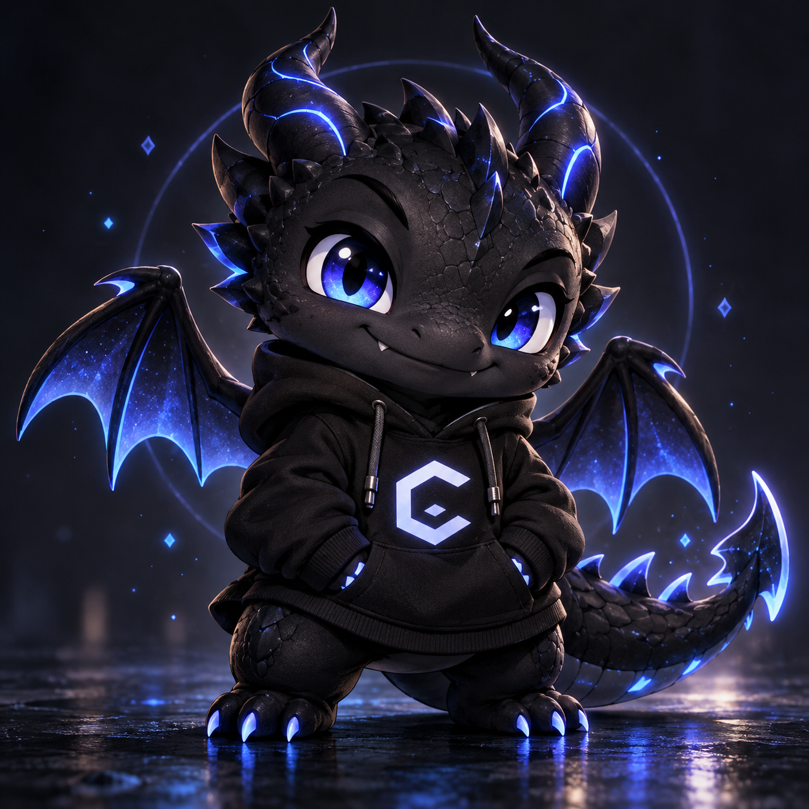

# CodeDragon

Mascote animado de um pequeno dragão chibi preto, com olhos azuis e detalhes em azul neon, criado para acompanhar sessões de programação.

**Projeto pessoal e independente. Não é um produto oficial da OpenAI e não representa vínculo ou endosso da empresa.**



## Aparência

- Escamas pretas e detalhes em azul neon.
- Olhos azuis grandes, dois chifres, pequenas asas e cauda.
- Moletom preto com capuz, bolso frontal e o emblema angular da referência.
- Spritesheet com fundo transparente.

## Animações implementadas

| Estado | Quadros | Movimento |
| --- | ---: | --- |
| `idle` | 6 | Respiração suave e piscar |
| `running-right` | 8 | Corrida para a direita, alternando patas e asas |
| `running-left` | 8 | Corrida para a esquerda, preservando o emblema |
| `waving` | 4 | Saudação com uma pata |
| `jumping` | 5 | Salto de sucesso com pequena chama azul |
| `failed` | 8 | Expressão triste e fumaça ligada ao nariz |
| `waiting` | 6 | Espera por interação, mudança de olhar e cauda |
| `running` | 6 | Trabalho: patas como se estivessem digitando |
| `review` | 6 | Inspeção, inclinação da cabeça e pata no queixo |

As duas últimas linhas contêm **16 direções de olhar**, em sentido horário, a partir de cima, em passos de 22,5 graus. O estado `running` representa trabalho ativo; a locomoção usa os dois estados direcionais.

## Formato e requisitos

- PNG RGBA transparente, **1536 × 2288 pixels**.
- Formato de spritesheet **v2**: 8 colunas × 11 linhas.
- Células de 192 × 208 pixels, 73 quadros ocupados e 15 células transparentes sem uso.
- Aplicativo e conta com o plugin **Pets** e suporte a esse formato. O fluxo verificado foi o do Pets no modo Work; a disponibilidade da integração pode variar conforme o aplicativo e a conta.
- Este repositório não exige dependências, instaladores ou scripts executáveis.

## Instalação pelo fluxo verificado

O procedimento utilizado na criação foi a validação e importação da spritesheet pelo plugin Pets. Clonar este repositório apenas baixa os arquivos; não instala o Pet automaticamente.

1. Baixe [spritesheet.png](pets/codedragon/spritesheet.png), preservando o PNG e sua transparência.
2. Em uma conversa com o plugin Pets disponível, anexe o arquivo e solicite: **“Valide e importe esta spritesheet v2 pronta, sem redesenhar os quadros. Crie o Pet com o nome CodeDragon e selecione-o como ativo.”**
3. O fluxo deve validar o arquivo com `validate_pet_spritesheet`, preparar a transferência com `prepare_pet_upload` e criar o Pet com `create_pet`, usando o nome **CodeDragon**.
4. A ativação usa `select_pet`; a confirmação é feita consultando `list_pets` e verificando que CodeDragon está ativo.

Essas etapas de validação, criação e seleção foram executadas e verificadas na criação deste Pet. Uma instalação em outra conta depende do suporte do plugin nessa conta. Não foi verificada instalação manual por cópia em pastas internas do Codex; esse método não é indicado aqui.

Se CodeDragon já estiver na sua coleção, solicite apenas sua seleção, evitando criar outra cópia. Nenhum identificador da conta original é necessário nem distribuído neste repositório.

## Estrutura

```text
.
├── README.md
├── .gitignore
├── assets/
│   └── reference/
│       └── codedragon.png
└── pets/
    └── codedragon/
        ├── pet-manifest.json
        └── spritesheet.png
```

`pet-manifest.json` preserva os metadados exportados da montagem: geometria da grade, célula neutra e posições das direções de olhar. O caminho da imagem foi ajustado para o arquivo distribuído. Esse documento descreve a spritesheet; não é um instalador ou uma configuração nativa de instalação por pasta.

## Validação e limitações

A spritesheet passou nas verificações de dimensões, transparência, células obrigatórias, isolamento dos quadros, salto e direções de olhar. A revisão independente confirmou os eixos de olhar por maioria. Algumas inclinações intermediárias são sutis.

A importação e seleção do Pet original foram confirmadas pelo plugin. Isso não equivale a um teste visual em todas as versões do aplicativo ou em outras contas. O pacote público contém somente as duas imagens, metadados geométricos e documentação; não contém sessões, configurações pessoais, registros de ativação ou ferramentas de geração.

## Melhorias futuras

- Refinar a suavidade das transições entre olhares intermediários.
- Acrescentar prévias de movimento específicas para a documentação.
- Documentar outros métodos de instalação somente depois de verificá-los.
